<p align="center">
  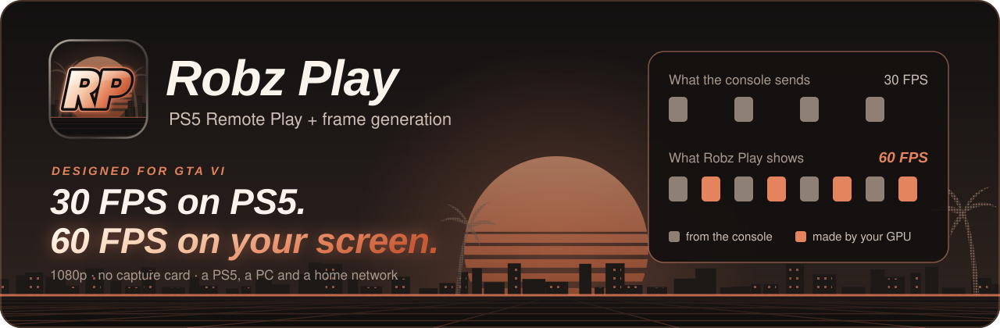
</p>

<p align="center">
  <a href="https://github.com/kutsalkiremitci/robz-play/releases/latest"></a>
  <a href="https://github.com/kutsalkiremitci/robz-play/releases"></a>
  <a href="https://github.com/kutsalkiremitci/robz-play/stargazers"></a>
  <a href="COPYING"></a>
  <br>
  
  
  
  
  
</p>

<p align="center">
  <a href="#step-by-step-setup"></a>
  <a href="#how-does-it-work"></a>
  <a href="#faq-and-troubleshooting"></a>
  <a href="https://kutsalkiremitci.github.io/robz-play/en/"></a>
  <a href="README.md"></a>
</p>

# 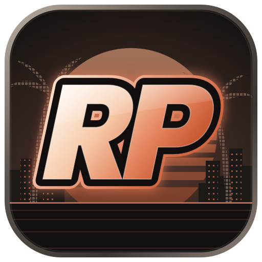 Robz Play

**Robz Play is designed for GTA VI: it plays a game that runs at 30 FPS on the PS5 on your PC's screen at 1080p, as smooth as 60 FPS.** It connects to your PS5 over your home network with Remote Play, and your PC's graphics card generates the frames in between. No capture card needed: a PS5, a PC and the network they share are enough.

- **1080p · 60 FPS:** a PS5 Remote Play stream. You play your console from your PC; the picture is what the console sends.
- **30 → 60 FPS:** your graphics card generates the frames in between. The 120 FPS option is experimental.
- **No capture card:** a PS5, a PC and your home network are enough.
- **Turkish:** the interface opens in Turkish; English is there too.

Frame generation is optional: switch it on or off with one click in the **Picture mode** section in the middle of the home screen. GTA VI runs at 30 FPS on consoles; that is why frame generation was written, and it was developed while playing GTA VI. The same method works in every PS5 and PS4 game locked to 30 FPS.

<p align="center">
  <a href="https://github.com/kutsalkiremitci/robz-play/releases/latest/download/RobzPlay-Setup.exe"></a>
  <a href="https://discord.gg/UyyEn7SHm4"></a>
  <a href="https://kick.com/robzsogood"></a>
</p>
<p align="center">
  <sub>The download link always gives the latest release. Earlier releases and their changes: <a href="https://github.com/kutsalkiremitci/robz-play/releases">GitHub releases</a>.</sub>
</p>

<p align="center">
  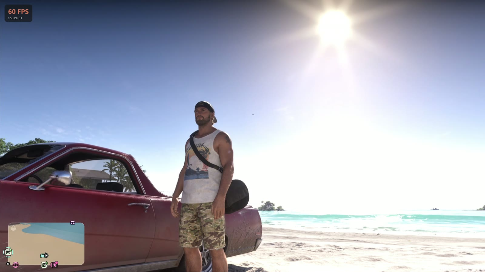
</p>
<p align="center">
  <sub>GTA VI with Robz Play. The counter at the top left shows the frame rate on screen (60 FPS) and the source coming from the console (about 30).</sub>
</p>

## See the difference: 30 FPS and 60 FPS side by side

The same GTA VI recording: on the left the picture brought down to 30 FPS, on the right the 60 FPS Robz Play shows. The difference is plain when the camera turns and while driving.

<p align="center">
  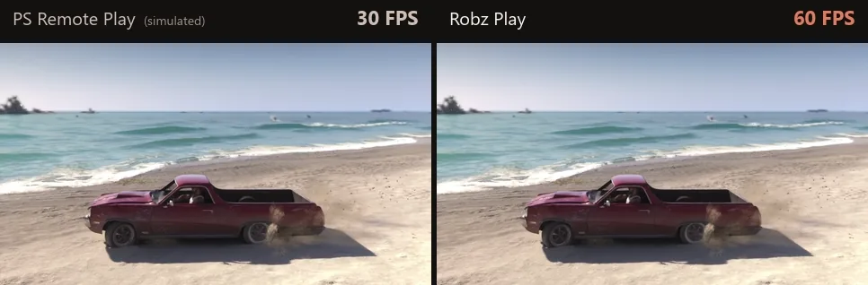
</p>
<p align="center">
  <sub>The left side is simulated: it is the same recording brought down to 30 FPS. It was recorded from the Robz Play window with OBS; the animation plays at its true speed of 60 FPS.</sub>
</p>

A GIF version of the comparison: [`assets/robzplay/gta-vi-30-vs-60-en.gif`](assets/robzplay/gta-vi-30-vs-60-en.gif). The GIF format can show at most 50 FPS, so that file plays at 83 % speed; the animation above plays at its true speed of 60 FPS.

### PS Remote Play and Robz Play

| | PS Remote Play<br><sub>set to 720p · 30 FPS</sub> | Robz Play |
|---|:---:|:---:|
| **Frame rate you see in GTA VI** | 30 FPS | **60 FPS** |
| **Resolution** | 720p | **1080p** |
| **Frame generation** | None | **Yes**, on the graphics card |
| **Source code** | Closed | **Open** (AGPL-3.0) |

> [!NOTE]
> To keep the comparison fair: the official PS Remote Play app can also be set to 1080p and a 60 FPS stream. But that app does not generate frames; GTA VI runs at 30 FPS, so the motion you see is still 30 FPS. What makes the difference is that Robz Play generates the frames in between.

## Before you start: what do you need?

No extra hardware. Your console, your PC and the home network they share are enough.

| | |
|---|---|
| **PlayStation 5** | A PS4 works too. Remote Play must be on on the console (shown in [step 4](#4-prepare-the-ps5)). |
| **Windows 10 or 11** | A 64-bit PC. A 60 Hz screen for 60 FPS, 120 Hz or higher for 120 FPS. |
| **A separate graphics card with Vulkan** | NVIDIA GTX/RTX, AMD Radeon RX or Intel Arc. The graphics card generates the frames; this is not DLSS and not specific to NVIDIA. |
| **The same home network** | The PS5 and the PC must be on the same network. Connecting both to the router with a cable gives the steadiest picture. |
| **A PlayStation account** | You sign in to PSN once while connecting the console to the app. If your console is already connected in chiaki-ng, not even that. |

**Not needed:** a capture card, an HDMI splitter or a second device. The integrated graphics inside the processor are not enough, though: one frame takes seconds.

### Is your graphics card enough?

Your graphics card needs to generate an in-between frame in under about 10 milliseconds.

| Graphics card | What to expect | Status |
|---|---|---|
| Integrated graphics (Intel UHD, AMD Radeon Graphics) | Does not work: one frame takes seconds | Measured (AMD integrated: ~2.7 s/frame) |
| Entry-level separate card (GTX 1650 class) | 60 FPS may be possible with "Fast" motion detail | Estimate, not tried |
| Mid-range (RTX 3060, RX 6600 XT class and up) | 60 FPS on "Balanced" | Estimate, not tried |
| RTX 4070 | 60 FPS on "Balanced": ~5-10 ms per frame. 120 FPS works, experimentally | Measured |

So far it has **only really been tested on an RTX 4070**; the other rows are estimates and will be updated as more cards are tried. If your card struggles, set **Motion detail** to "Fast": motion is measured at a quarter of the picture's resolution and the load drops clearly.

## Step-by-step setup

From the download to your first game. The first four steps are preparation; the rest happen in the app. The screenshots were taken from Robz Play 0.4.1, with the console's address and ID hidden by streamer mode.

### Preparation

#### 1. Download the installer

<a href="https://github.com/kutsalkiremitci/robz-play/releases/latest/download/RobzPlay-Setup.exe"></a>

`RobzPlay-Setup.exe` is always the latest release. It is free; no account or sign-up is needed to download it. The changes of every release and the file's SHA-256 value are on the [releases page](https://github.com/kutsalkiremitci/robz-play/releases).

#### 2. Get past the Windows warning

The installer is not signed yet, so on the first run Windows may show **"Windows protected your PC"**. Click **More info** first, then **Run anyway**.

#### 3. Install and open

Finish the setup; it does not ask for administrator rights. Robz Play is installed in `%LOCALAPPDATA%\Programs\Robz Play`. Open it from the **Robz Play** shortcut on the desktop or in the Start menu.

#### 4. Prepare the PS5

The order matters: users first, then Remote Play.

**1) Add a second, empty user.** On the PS5, open the profile icon at the top right of the home screen (or open the control center with the PS button), choose **Switch User**, then **Add User**; an empty game profile is enough. With a single user on the console, after you press **Play** the PS5 can turn on, pick that user by itself and send Remote Play back to the home screen. With two users, once connected the PS5 asks who plays: **choose the second profile, not your main one**, and continue. If a controller (DualSense) is connected to your PC, you can continue with the main profile too.

**2) Remove the login passcode.** If your profile has a PS5 login passcode (the 4-digit one), remove it; it can cause connection problems.

**3) Switch on Remote Play on every profile:**

> **Settings › System › Remote Play › Enable Remote Play**

To connect while the console is in rest mode too, switch on both options here:

> **Settings › System › Power Saving › Features Available in Rest Mode**

### In Robz Play

#### 5. First start: your console shows up by itself

Robz Play opens in Turkish; for English, click the flag in the menu on the left. If the PS5 and the PC are on the same network, your console appears at the top of the home screen by itself. In the middle is the **Picture mode** section, where you choose how the game is shown.

<p align="center">
  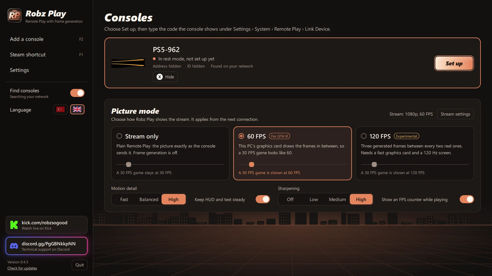
</p>
<p align="center">
  <sub>The home screen. The console card says "Address hidden" and "ID hidden": streamer mode was on when the picture was taken.</sub>
</p>

> [!TIP]
> **Do you use chiaki-ng?** On its first start Robz Play takes chiaki-ng's settings and registered consoles by itself; if your console is already connected, skip step 6. Whatever is selected in chiaki-ng, frame generation comes on, with 60 FPS and Vulkan. chiaki-ng's own settings are not touched.

#### 6. Connect the console (once)

Press **Set up** on your console's card.

<p align="center">
  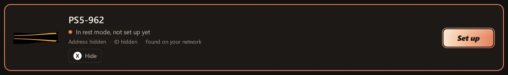
</p>

The **Register Console** screen that opens goes in four steps. To the right of each step it says what the step is for and what to do on the console; the **Back** and **Continue** buttons are under the form.

1. **Console:** PS5 is selected and the address found on the network is filled in. Press **Continue**.
2. **Account:** there are two ways. If you signed in before, it says "Account ready" and this step is skipped.
   - **1 · Sign in in the browser** (recommended, always works): press **Open sign-in page** and sign in with the account you use on the console. When signing in is done, the browser opens an empty or error-like page; that is normal. Click the address bar, press **Ctrl+A** and **Ctrl+C**, and go back to Robz Play: the address is picked up by itself (if not, paste it into the box). The code in the address is valid for a few minutes.
   - **2 · Find by online ID** (no sign-in needed): type your PSN user name and press **Find**. To be found, set everything under **Settings › Users and Accounts › Privacy** on the PS5 to **Anyone**. This lookup is not Sony's: sometimes it does not open or answer at first, and works after a few tries.
3. **Pairing code:** on the PS5, choose **Settings › System › Remote Play › Link Device** and type the 8-digit code shown on the screen. Get the code while on the profile of the account you signed in with in step 2 (your main profile): a code taken on the second, empty profile gives an "Invalid PSN ID" error.
4. **Register:** check the summary and press **Register console**. When it says "Console registered", press **Done**.

<p align="center">
  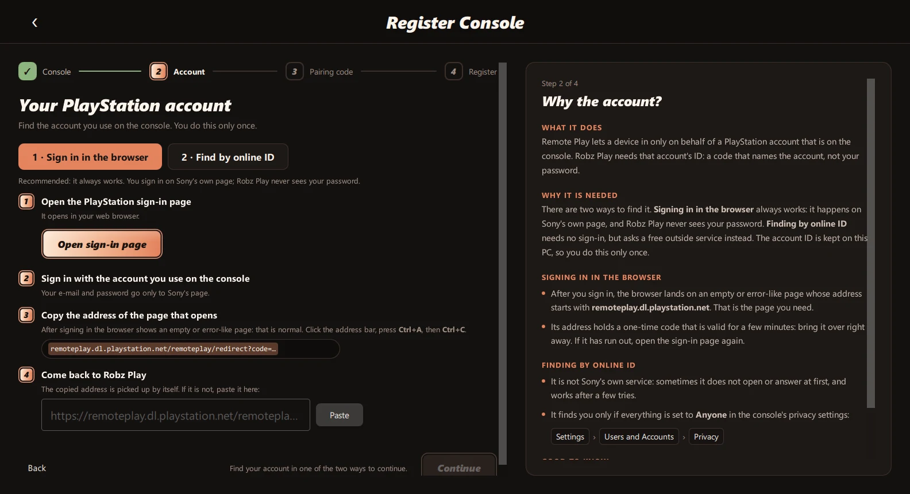
  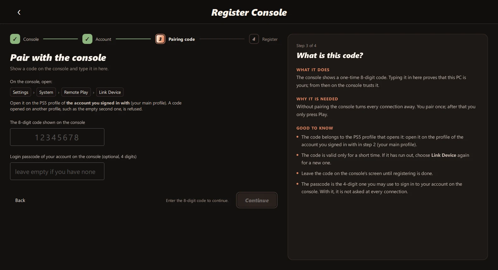
</p>
<p align="center">
  <sub>Step 2 on the left (PlayStation account, two ways), step 3 on the right (the code on the PS5). The screenshots were taken with streamer mode on.</sub>
</p>

#### 7. Choose the picture mode

For GTA VI choose **60 FPS**; it is the default. If you do not want frame generation, **Stream only**; if you have a strong card and a 120 Hz screen, the experimental **120 FPS**. The mode applies from the next connection. **Motion detail**, **Keep HUD and text steady**, **Sharpening** and the **FPS counter** below it are changed here too.

<p align="center">
  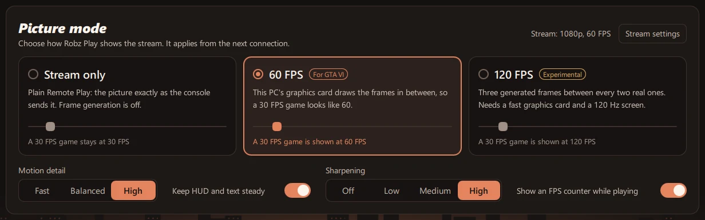
</p>

#### 8. Play

Once the console is registered, a **Play** button appears on its card. When you press it, Robz Play connects to the PS5; if the rest mode settings from step 4 are on, a sleeping console is woken up too. The game picture appears once connected.

<p align="center">
  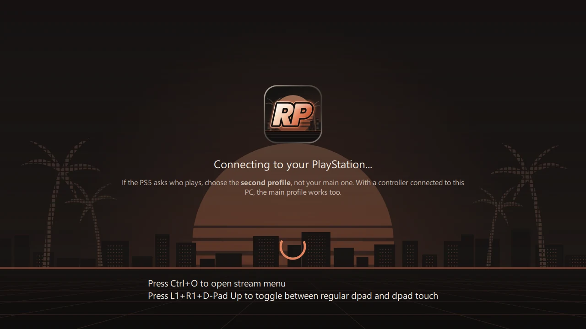
</p>
<p align="center">
  <sub>The screen shown while connecting.</sub>
</p>

#### 9. While playing: the stream menu

`Ctrl + O` opens the stream menu: volume, microphone, zoom, sharpening, the FPS counter and the renderer settings change without leaving the game.

<p align="center">
  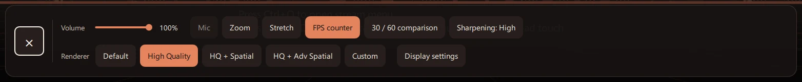
</p>
<p align="center">
  <sub>The stream menu opens at the bottom of the screen.</sub>
</p>

#### 10. Settings

**Settings** in the menu on the left has the settings for frame generation, video, stream, audio, consoles, keyboard and controllers. The values in brackets are the defaults. On the **Stream** page, resolution, FPS, bitrate and codec are chosen separately for connections at home (Local) and away from home (Remote).

<p align="center">
  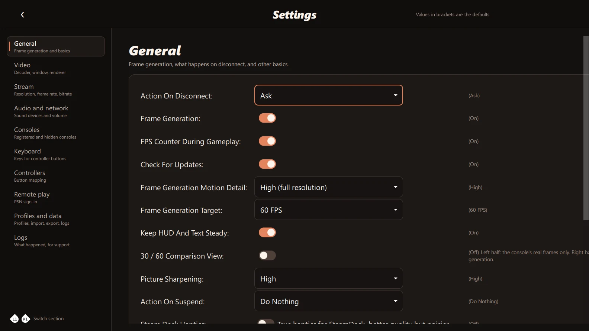
</p>
<p align="center">
  <sub>General: frame generation and basic settings.</sub>
</p>

<p align="center">
  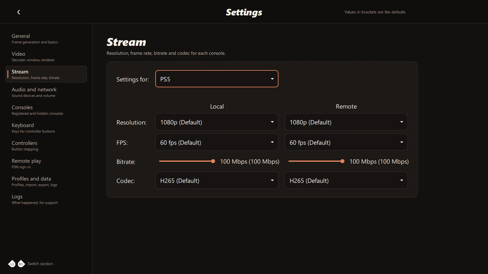
</p>
<p align="center">
  <sub>Stream: 1080p, 60 FPS, 100 Mbps, H265.</sub>
</p>

### Updating and uninstalling

- **To update**, you do not need to do anything. When a new release is out, Robz Play shows the changes in a **What's new** window; **Update now** downloads and installs the new release and reopens the app. The app checks by itself at start-up and every few hours; if you do not want to wait, click **Check for updates** under the version number at the bottom left. If you are up to date, it says "Robz Play is up to date". You can also simply download and run the new `RobzPlay-Setup.exe`. Your settings and registered consoles are kept either way.
- **To uninstall**, remove Robz Play from the "Installed apps" list in Windows. Your settings stay in the Windows registry.

<details>
<summary><b>Building from source</b> (for developers)</summary>

1. Install [MSYS2](https://www.msys2.org/) in its default location (`C:\msys64`) and open the **MSYS2 MINGW64** shell.
2. Download the repository with its submodules:

   ```bash
   git clone -c core.autocrlf=false --recursive https://github.com/kutsalkiremitci/robz-play.git
   cd robz-play
   ```

3. Install the dependencies once (takes a while), then build:

   ```bash
   ./scripts/robzplay-setup-msys2.sh
   ./scripts/robzplay-build.sh
   ```

4. Double-click **`start.bat`** in the repository folder. The app opens from the `dist\RobzPlay` folder.

To make the published installer (`RobzPlay-Setup.exe`) and the portable zip package: `./scripts/robzplay-package.sh`.

</details>

## Three picture modes

In the middle of the home screen. Frame generation is optional: one click switches it on, off or changes its target.

| Mode | What it does | What you see in GTA VI running at 30 FPS |
|---|---|:---:|
| **Stream only** | Plain Remote Play: a 1080p, 60 FPS stream, as the console sends it. Frame generation off, no added latency. | 30 FPS |
| **60 FPS** `For GTA VI` | Your PC's graphics card draws the frames in between; a 30 FPS game looks like 60 FPS. The default and recommended mode. | **60 FPS** |
| **120 FPS** `Experimental` | Generates three frames between every two real ones. Needs a strong graphics card and a 120 Hz or faster screen. | 120 FPS |

**Good to know**

- The mode applies from the next connection.
- In a game that already runs at 60 FPS, "Stream only" and "60 FPS" give the same picture; the difference shows in games locked to 30 FPS.
- Sharpening and the FPS counter apply at once, frame generation settings from the next stream.

### Why is 120 FPS experimental?

- It asks more of the graphics card than the 60 FPS mode.
- Three frames out of four are generated, so glitches are easier to notice in fast motion.
- It has only been tested on one system (RTX 4070). If you have problems, go back to 60 FPS; it is the recommended mode for everyday use.

## Settings

### Default settings

Robz Play was developed and tested with these settings:

| Renderer | Codec | Resolution | Stream | Bitrate | Volume |
|:---:|:---:|:---:|:---:|:---:|:---:|
| **Vulkan** | **H265** | **1080p** | **60 FPS** | **100 Mbps** | **100%** |

| Motion detail | Sharpening | FPS counter |
|:---:|:---:|:---:|
| **High** | **High** | **On** |

Motion detail **High** is about three times heavier on the graphics card than **Balanced**; if your card struggles, set it to Balanced or Fast under **Settings › General**.

Vulkan is selected as the renderer because the developer's other app, Robz Vision, which reads subtitles from the picture, cannot capture the OpenGL picture. When connecting from away from home, 100 Mbps is too much for the upload speed of most home connections; lower the bitrate in the **Remote** column on the **Settings › Stream** page.

### Frame generation settings

| Setting | Options | What it does |
|---|---|---|
| Picture mode | Stream only / 60 FPS / 120 FPS `Experimental` | Switches frame generation off or chooses its target. It is in the middle of the home screen. |
| Motion detail | Fast / Balanced / High | The resolution motion is measured at. High is cleaner, but about three times heavier on the graphics card. |
| Keep HUD and text steady | On / Off | Keeps fixed interface elements in place in generated frames. |
| Sharpening | Off / Low / Medium / High | Makes the stream sharper; applies at once. |
| FPS counter | On / Off | The shown and the source FPS at the top left. |

## Highlights

| | |
|---|---|
| **1080p, 60 FPS Remote Play** | Connect to your PS5 over your home network and play from your PC. It works without frame generation too. |
| **30 → 60 FPS** | GTA VI and other PS5 and PS4 games locked to 30 FPS, as smooth as 60 FPS. |
| **120 FPS** `Experimental` | Generates three frames between every two real ones; for details, [see above](#why-is-120-fps-experimental). |
| **HUD and text protection** | Fixed elements such as the health bar, the minimap and subtitles stay in place in generated frames and do not shimmer. |
| **Sharpening** | Brings back the sharpness the compressed stream loses; changes at once while playing. |
| **FPS counter that shows in OBS** | Shows the displayed and the source FPS together. It is drawn into the picture, so it shows in recordings too. |
| **In-stream menu** | `Ctrl + O`: volume, microphone, zoom, sharpening, FPS counter. |
| **Turkish and English** | The app opens in Turkish; the flags in the menu on the left change the language. |
| **Update notices** | When a new release is out, a "What's new" window shows the changes in your language; "Update now" downloads and installs it and reopens the app. With "Check for updates" you can look yourself any time. |
| **Technical support on Discord** | One click on the Discord button in the menu on the left takes you to free technical support. |
| **Start-up log** | Every start is written to a log file; if something goes wrong, you can see where. |
| **Moving from chiaki-ng** | On its first start it takes chiaki-ng's settings and registered consoles. chiaki-ng's own settings are not touched. |
| **All of Remote Play** | Built on [chiaki-ng](https://github.com/chiaki-ng/chiaki-ng): DualSense support, connecting from away from home over PSN, button mapping, profiles. |

## How does it work?

The PS5 still runs the game at 30 FPS. What becomes smoother is the picture you see on your screen.

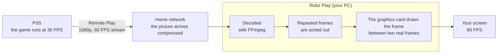

1. **PS5:** the game runs at 30 FPS. The picture is sent with Remote Play as a 1080p, 60 FPS stream; every frame arrives twice.
2. **Home network:** the picture reaches your PC compressed and is decoded with FFmpeg.
3. **Robz Play:** repeated frames are sorted out; the graphics card draws the frame between two real frames.
4. **Your screen:** 30 real and 30 generated frames a second, evenly spaced. The result is 60 FPS.

### Where does the in-between frame come from?

- Robz Play sorts out the copies in the stream and finds the game's real 30 frames.
- An AI model running on the graphics card, **RIFE v4.6**, measures the motion between two real frames in a row and draws the frame right between them. The model runs with [ncnn](https://github.com/Tencent/ncnn) and Vulkan, so it can run on NVIDIA, AMD and Intel cards.
- **Fixed HUD elements** such as the health bar, the minimap and subtitles **are protected separately**; they do not shimmer over a moving background.
- If the card cannot keep up with a frame, Robz Play skips generating it; the picture does not freeze.

### What it does, and what it is not

**What it does**

- In games locked to 30 FPS such as GTA VI, camera turns, driving and motion become visibly smoother.
- No extra hardware. No capture card, HDMI splitter or second device.
- Free and open source; what it does can be read in the code.

**What it is not**

- **It does not speed up the PS5.** The game still runs at 30 FPS on the console; what becomes smoother is the picture on your screen.
- **It does not reduce latency; it adds a little.** On top of Remote Play's own latency, the next real frame is waited for to draw the in-between frame (about 33 ms at 30 FPS). Single-player games play comfortably; it is not for competitive games.
- **It is not HDMI quality.** The picture arrives compressed over the network; it is not as sharp as a PS5 connected straight to a TV. Sharpening narrows the gap, it does not close it.
- **It is not flawless.** In very fast motion and fine patterns, glitches can show in generated frames.
- **It is not an official product.** It has no connection with Sony Interactive Entertainment, PlayStation, Rockstar Games or Take-Two, and is not endorsed by them.

## Technologies used

Robz Play stands on the shoulders of open source. Thanks to the developers of these projects.

| Project | Its job in Robz Play |
|---|---|
| [chiaki-ng](https://github.com/chiaki-ng/chiaki-ng), and before it Florian Märkl's [Chiaki](https://git.sr.ht/~thestr4ng3r/chiaki) | The whole Remote Play connection |
| [Qt 6 / QML](https://www.qt.io/) | Interface |
| [libplacebo](https://code.videolan.org/videolan/libplacebo) + Vulkan | Image processing and drawing to the screen |
| [FFmpeg](https://ffmpeg.org/) | Decoding the stream |
| [RIFE](https://github.com/hzwer/Practical-RIFE) v4.6 (hzwer), [rife-ncnn-vulkan](https://github.com/nihui/rife-ncnn-vulkan) (nihui) and [ncnn](https://github.com/Tencent/ncnn) | Frame generation, on the graphics card |
| [NSIS](https://nsis.sourceforge.io/) | Installer |
| [MSYS2](https://www.msys2.org/) / MinGW | Building for Windows |

## FAQ and troubleshooting

If you cannot find the answer here, write on our Discord server; setup help is free. The **Technical support on Discord** button in the menu on the left of the app takes you there too.

<a href="https://discord.gg/UyyEn7SHm4"></a>

### Installing and starting

<details>
<summary><b>Windows says "Windows protected your PC"</b></summary>

The installer is not signed yet, so Windows may show this warning. Click **More info**, then **Run anyway**. A signed installer is on the roadmap.

</details>

<details>
<summary><b>Robz Play does not open or shows an error</b></summary>

First install the latest release: 0.3.0 fixed a start-up problem on PCs whose Windows user name contains Turkish letters such as ğ, ı or ş. If the problem continues, look at the logs and make the diagnostics file (below).

</details>

<details>
<summary><b>Where are the logs?</b></summary>

The **"Robz Play günlükleri"** (Robz Play logs) shortcut in the Start menu opens the log folder: `%APPDATA%\RobzPlay\RobzPlay\log`

- `robzplay-acilis.log`: written at every start; the start before is kept as `robzplay-acilis-onceki.log`. If the app crashes, the last line says in which file.
- `chiaki_session_….log`: each stream's own log.

</details>

<details>
<summary><b>Which file should I send when asking for support?</b></summary>

Double-click **`Tani.bat`** in the install folder (`%LOCALAPPDATA%\Programs\Robz Play`). It writes the details of your PC, your graphics card and the last starts to `robzplay-tani.txt` on your desktop. Attach that file when you describe your problem on Discord.

</details>

<details>
<summary><b>I use chiaki-ng. Do I have to set everything up again?</b></summary>

No. On its first start Robz Play takes chiaki-ng's settings and registered consoles by itself; you do not need to connect the console again. chiaki-ng's own settings are not touched.

</details>

<details>
<summary><b>How do I update, how do I uninstall?</b></summary>

See [Updating and uninstalling](#updating-and-uninstalling) above.

</details>

### Connection and picture

<details>
<summary><b>The controller disconnects when I press "Play"</b></summary>

If the stream opens but the DualSense does not work in the game or keeps disconnecting, the reason is that the PS5 has only one user profile. Robz Play uses the same Remote Play connection as chiaki-ng, and with this connection a controller coming in remotely needs a second user profile on the console. So the problem does not come from frame generation, but from this behaviour of Remote Play (and chiaki-ng).

The fix:

1. Add a new user profile (a second account) on the PS5: open the profile icon at the top right of the home screen (or open the control center with the PS button), choose **Switch User**, then **Add User**.
2. If your profile has a PS5 login passcode, remove it; it can cause connection problems.
3. Press **Play** in Robz Play again. This time the PS5 shows a profile selection screen with the two profiles.
4. Choose the **second profile** and continue; the controller works. If a controller (DualSense) is connected to your PC, you can continue with the main profile too.

**Important for GTA VI:** to play a game bought on your main account with the second profile, **Console Sharing and Offline Play** must be on for that PS5 on the main account: on the PS5, with the main account, **Settings › Users and Accounts › Other › Console Sharing and Offline Play**. On the account set up first on the console this is usually already on.

Menu names can differ slightly depending on the PS5 system software version. If the connection still drops after these steps, ask on Discord and attach the `robzplay-tani.txt` file.

</details>

<details>
<summary><b>My console does not show up on the home screen</b></summary>

Make sure Remote Play is on on the PS5 (**Settings › System › Remote Play**) and that the PS5 and the PC are on the same network. The **Find consoles** switch on the left of the home screen must be on. If the console is in rest mode, both options under **Settings › System › Power Saving › Features Available in Rest Mode** must be on.

</details>

<details>
<summary><b>The picture stutters or breaks up</b></summary>

Connect the PS5 and the PC to the router with a cable. A wired connection gives the steadiest picture; stutters are more common over Wi-Fi.

</details>

<details>
<summary><b>My graphics card struggles</b></summary>

Set **Motion detail** on the home screen to "Fast". Motion is measured at a quarter of the picture's resolution and the load drops clearly. At moments when frame generation cannot keep up, Robz Play skips generating frames by itself; the picture does not freeze. If you use 120 FPS, go back to 60 FPS.

The integrated graphics inside the processor are not enough for frame generation; a separate graphics card with Vulkan is needed. To play without frame generation, choose the "Stream only" mode.

</details>

<details>
<summary><b>I see glitches in generated frames</b></summary>

Motion is estimated from the picture, so in very fast motion and fine patterns glitches can show in generated frames. In the 120 FPS mode they are more noticeable, as three frames out of four are generated. Keep **Keep HUD and text steady** on. If your card can take it, you can set **Motion detail** to "High": it gives a cleaner result, but is about three times heavier on the graphics card.

</details>

<details>
<summary><b>Is there latency? Can it be used in competitive games?</b></summary>

Frame generation adds a little latency: the next real frame is waited for to draw the in-between frame (about 33 ms at 30 FPS), on top of Remote Play's own latency. Single-player games play comfortably; it is not for competitive games. In games where latency matters, choose the "Stream only" mode.

</details>

<details>
<summary><b>Can I connect from away from home?</b></summary>

Yes, Remote Play supports connecting from away from home with a PSN account (**Settings › Remote play › Sign in to PSN**). But the default 100 Mbps is too much for the upload speed of most home connections: lower the bitrate in the **Remote** column on the **Settings › Stream** page. On a weak connection, picture quality and latency get worse.

</details>

### General

<details>
<summary><b>Do I need a capture card?</b></summary>

No. The picture comes from the PS5 over the network, with Remote Play.

</details>

<details>
<summary><b>Is this DLSS? My graphics card is not NVIDIA.</b></summary>

No, this is not DLSS and it uses no technology specific to NVIDIA or AMD. Frame generation is done by the open source RIFE v4.6 model with ncnn and Vulkan; it works on separate graphics cards that support Vulkan (NVIDIA GTX/RTX, AMD Radeon RX, Intel Arc). So far it has only been tested on an RTX 4070.

DLSS runs inside the game and takes motion information from the game engine. GTA VI, though, runs on the PS5; only the picture reaches the PC. Robz Play estimates the motion from that picture. That is why it works on every brand of card and in every game opened with Remote Play.

</details>

<details>
<summary><b>Which games does it work with?</b></summary>

It was designed for GTA VI and developed while playing GTA VI, but it works in every PS5 and PS4 game that Remote Play allows. The biggest difference shows in games locked to 30 FPS; in a game that already runs at 60 FPS, the 60 FPS mode adds nothing.

</details>

<details>
<summary><b>Can I stream or record with OBS?</b></summary>

Yes. Add the Robz Play window as a game capture source; the generated frames and the FPS counter go into the recording.

</details>

<details>
<summary><b>Is HDR supported?</b></summary>

Frame generation has not been tried with an HDR stream yet.

</details>

<details>
<summary><b>Does it cost anything? Is it an official app?</b></summary>

It is free and open source (AGPL-3.0). It is not an official product: it has no connection with Sony Interactive Entertainment, Rockstar Games or Take-Two Interactive and is not endorsed by them.

</details>

## Roadmap

- A signed installer.
- A graphics card speed test on the first start, and settings chosen from it.
- Reducing the added latency.
- Quality tuning with real game footage; testing on more graphics cards.

## For developers

- The frame generation core is in the `robzfg/` folder: the RIFE v4.6 model, running with [ncnn](https://github.com/Tencent/ncnn) and Vulkan. Speed and quality are measured with the `robzfg-lab` tool.
- The interface is Qt 6 / QML (`gui/src/qml`). The translations are in one file: `gui/res/i18n/tr.json`. `python gui/tools/i18n_extract.py` lists missing translations.
- To see the interface without a console, use the `ROBZPLAY_UI_PREVIEW` environment variable (`stream-loading`, `stream-menu`, `home-empty`); to try things without touching your settings, `ROBZPLAY_SETTINGS_ORG`.
- To test frame generation on the PC without a PS5: `ROBZPLAY_FRAMEGEN_SELFTEST=1`.
- To test the update check: `ROBZPLAY_UPDATE_URL` points to another release source, `ROBZPLAY_VERSION_OVERRIDE` makes the app think it is another version. Release notes are split into languages with the lines `<!-- robzplay:tr -->`, `<!-- robzplay:en -->` and `<!-- robzplay:end -->`.

## License

**Robz Play is a modified version of [chiaki-ng](https://github.com/chiaki-ng/chiaki-ng) 1.10.1.** The changes began on 20 November 2026 and can all be seen in this repository's commit history (the last commit taken over from chiaki-ng: `43728af2`). Robz Play is not made or endorsed by the chiaki-ng or Chiaki developers; report problems with Robz Play to [this repository](https://github.com/kutsalkiremitci/robz-play/issues), not to them.

Like chiaki-ng, Robz Play is licensed under **AGPL-3.0-only** (with the OpenSSL exception); the full text is in the [`LICENSES`](LICENSES) folder and the [`COPYING`](COPYING) file. The RIFE model and the rife-ncnn-vulkan code are MIT licensed; their license texts are in the folders concerned.

PlayStation, PS5, PS4 and DualSense are trademarks of Sony Interactive Entertainment. Grand Theft Auto and GTA are trademarks of Take-Two Interactive; the game images on this page belong to Rockstar Games and are used only to show how Robz Play works. This project is not endorsed or supported by Sony Interactive Entertainment, Rockstar Games or Take-Two Interactive.

---

<p align="center">
  <a href="https://kutsalkiremitci.github.io/robz-play/en/"></a>
  <a href="README.md"></a>
  <a href="https://discord.gg/UyyEn7SHm4"></a>
  <a href="https://kick.com/robzsogood"></a>
</p>
