<p align="center">
  
</p>

<p align="center">
  
  
  
  <a href="https://github.com/kutsalkiremitci/robz-play/releases/latest"></a>
  
  
  
  <a href="https://kick.com/robzsogood"></a>
  <a href="https://discord.gg/UyyEn7SHm4"></a>
</p>

<p align="center">
  <b><a href="https://github.com/kutsalkiremitci/robz-play/releases/latest/download/RobzPlay-Setup.exe">İndir</a></b> ·
  <a href="#adım-adım-kurulum">Kurulum</a> ·
  <a href="#nasıl-çalışır">Nasıl çalışır?</a> ·
  <a href="#sık-sorulanlar-ve-sorun-giderme">Sık sorulanlar</a> ·
  <a href="https://discord.gg/UyyEn7SHm4">Teknik destek</a> ·
  <a href="https://kutsalkiremitci.github.io/robz-play/">Web sitesi</a> (<a href="https://kutsalkiremitci.github.io/robz-play/en/">English</a>)
</p>

# Robz Play

**Robz Play, GTA VI için tasarlandı: PS5'te 30 FPS çalışan oyunu, bilgisayarının ekranında 1080p ve 60 FPS akıcılığında oynatır.** PS5'ine ev ağı üzerinden Remote Play ile bağlanır, aradaki kareleri bilgisayarının ekran kartı üretir. Capture card gerekmez: PS5, bilgisayar ve ikisinin bağlı olduğu ağ yeterli.

- **1080p · 60 FPS:** PS5 Remote Play yayını. Konsolunu bilgisayarından oynarsın; görüntü, konsolun gönderdiği gibidir.
- **30 → 60 FPS:** aradaki kareleri ekran kartın üretir. 120 FPS seçeneği deneyseldir.
- **Capture card yok:** PS5, bilgisayar ve ev ağı yeterli.
- **Türkçe:** arayüz Türkçe açılır, İngilizcesi de var.

Kare üretimi zorunlu değil: ana ekranın ortasındaki **Görüntü modu** bölümünden tek tıkla açılır ve kapanır. GTA VI konsollarda 30 FPS çalışıyor; kare üretimi bu yüzden yazıldı ve GTA VI oynanarak geliştirildi. Aynı yöntem 30 FPS'e kilitli bütün PS5 ve PS4 oyunlarında işe yarar.

<p align="center">
  <a href="https://github.com/kutsalkiremitci/robz-play/releases/latest/download/RobzPlay-Setup.exe"><b>Ücretsiz indir: RobzPlay-Setup.exe</b></a> (Windows 10 ve 11) ·
  <a href="https://discord.gg/UyyEn7SHm4"><b>Discord: ücretsiz kurulum desteği</b></a>
</p>
<p align="center">
  <sub>İndirme bağlantısı her zaman en son sürümü verir. Önceki sürümler ve değişiklikler: <a href="https://github.com/kutsalkiremitci/robz-play/releases">GitHub sürümleri</a>.</sub>
</p>

<p align="center">
  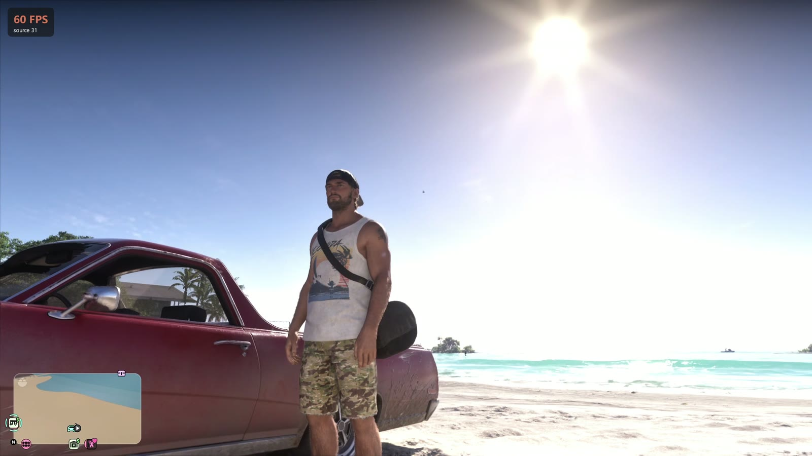
</p>
<p align="center">
  <sub>Robz Play ile GTA VI. Sol üstteki sayaç ekrana verilen kare hızını (60 FPS) ve konsoldan gelen kaynağı (yaklaşık 30) gösteriyor.</sub>
</p>

## Farkı gör: 30 FPS ile 60 FPS yan yana

Aynı GTA VI kaydı: solda görüntünün 30 FPS'e indirilmiş hali, sağda Robz Play'in ekrana verdiği 60 FPS. Kamera dönüşlerinde ve araç sürerken fark hemen göze çarpar.

<p align="center">
  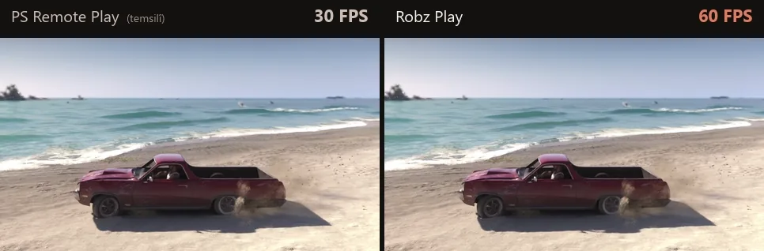
</p>
<p align="center">
  <sub>Sol taraf temsilîdir: aynı kaydın 30 FPS'e indirilmiş halidir. Kayıt OBS ile Robz Play penceresinden alındı; animasyon gerçek hızda 60 FPS oynar.</sub>
</p>

Karşılaştırmanın GIF sürümü: [`assets/robzplay/gta-vi-30-vs-60.gif`](assets/robzplay/gta-vi-30-vs-60.gif). GIF biçimi en fazla 50 FPS gösterebildiği için o dosya %83 hızda oynar; yukarıdaki animasyon gerçek hızda 60 FPS'tir.

### PS Remote Play ile Robz Play

| | PS Remote Play<br><sub>720p · 30 FPS ayarında</sub> | Robz Play |
|---|:---:|:---:|
| **GTA VI'da gördüğün kare hızı** | 30 FPS | **60 FPS** |
| **Çözünürlük** | 720p | **1080p** |
| **Kare üretimi** | Yok | **Var**, ekran kartında |
| **Kaynak kodu** | Kapalı | **Açık** (AGPL-3.0) |

> [!NOTE]
> Karşılaştırma dürüst olsun: resmî PS Remote Play uygulamasında da çözünürlük 1080p'ye, yayının kare hızı 60'a çıkarılabilir. Ama o uygulama kare üretmez; GTA VI 30 FPS çalıştığı için ekranda gördüğün hareket yine 30 FPS olur. Farkı yaratan, Robz Play'in aradaki kareleri üretmesidir.

## Başlamadan önce: neler gerekiyor?

Ek donanım yok. Konsolun, bilgisayarın ve ikisinin bağlı olduğu ev ağı yeterli.

| | |
|---|---|
| **PlayStation 5** | PS4 de olur. Konsolda Uzaktan Oynama açık olmalı ([4. adımda](#4-ps5i-hazırla) gösteriliyor). |
| **Windows 10 veya 11** | 64 bit bir bilgisayar. 60 FPS için 60 Hz, 120 FPS için 120 Hz veya üstü bir ekran. |
| **Vulkan destekli ayrı ekran kartı** | NVIDIA GTX/RTX, AMD Radeon RX ya da Intel Arc. Kare üretimini ekran kartı yapar; DLSS değildir, NVIDIA'ya özel değildir. |
| **Aynı ev ağı** | PS5 ile bilgisayar aynı ağda olmalı. İkisini de kabloyla modeme bağlamak en dengeli görüntüyü verir. |
| **PlayStation hesabı** | Konsolu uygulamaya bağlarken bir kez PSN girişi yapılır. chiaki-ng'de bağlı konsolun varsa bu da gerekmez. |

**Gerekmeyenler:** capture card, HDMI ayırıcı ya da ikinci bir cihaz. İşlemcinin içindeki tümleşik grafik ise yetmez: bir kare saniyeler sürer.

### Ekran kartın yeter mi?

Ekran kartının bir ara kareyi yaklaşık 10 milisaniyenin altında üretebilmesi gerekiyor.

| Ekran kartı | Beklenti | Durum |
|---|---|---|
| Tümleşik grafik (Intel UHD, AMD Radeon Graphics) | Çalışmaz: bir kare saniyeler sürüyor | Ölçüldü (AMD tümleşik: ~2,7 sn/kare) |
| Giriş seviyesi ayrı kart (GTX 1650 sınıfı) | 60 FPS, "Hızlı" ayrıntı modunda mümkün olabilir | Tahmin, denenmedi |
| Orta seviye (RTX 3060, RX 6600 XT sınıfı ve üstü) | 60 FPS, "Dengeli" modda | Tahmin, denenmedi |
| RTX 4070 | 60 FPS "Dengeli": kare başına ~5-10 ms. 120 FPS deneysel olarak çalışıyor | Ölçüldü |

Şimdiye kadar **yalnızca RTX 4070 ile gerçekten denendi**; diğer satırlar tahmindir ve denendikçe güncellenecek. Kartın zorlanırsa **Hareket ayrıntısı** ayarını "Hızlı"ya al: hareket, görüntünün dörtte biri çözünürlükte ölçülür ve iş yükü belirgin biçimde düşer.

## Adım adım kurulum

İndirmekten ilk oyuna. İlk dört adım hazırlık, sonrakiler uygulamanın içinde. Görüntüler Robz Play 0.3.0'dan alındı; konsolun adresi ve kimliği "yayıncı modu" ile gizlendi.

### Hazırlık

#### 1. Kurulum dosyasını indir

[**`RobzPlay-Setup.exe`**](https://github.com/kutsalkiremitci/robz-play/releases/latest/download/RobzPlay-Setup.exe) her zaman en son sürümdür. Ücretsizdir; indirmek için hesap ya da kayıt gerekmez. Her sürümün değişiklikleri ve dosyanın SHA-256 değeri [sürümler sayfasında](https://github.com/kutsalkiremitci/robz-play/releases) yazar.

#### 2. Windows uyarısını geç

Kurulum dosyası henüz imzalı olmadığı için Windows ilk çalıştırmada **"Windows kişisel bilgisayarınızı korudu"** uyarısını gösterebilir. Önce **Ek bilgi**'ye, sonra **Yine de çalıştır**'a bas.

#### 3. Kur ve aç

Kurulumu tamamla; yönetici izni istemez. Robz Play `%LOCALAPPDATA%\Programs\Robz Play` klasörüne kurulur. Masaüstündeki ya da Başlat menüsündeki **Robz Play** kısayolundan aç.

#### 4. PS5'i hazırla

PS5'te Uzaktan Oynama'yı aç:

> **Ayarlar › Sistem › Uzaktan Oynama › Uzaktan Oynama'yı Etkinleştir**

Konsol dinlenme modundayken de bağlanmak istersen buradaki iki seçeneği de aç:

> **Ayarlar › Sistem › Güç Tasarrufu › Dinlenme Modunda Kullanılabilen Özellikler**

### Robz Play'de

#### 5. İlk açılış: konsolun kendiliğinden görünür

Robz Play Türkçe açılır; İngilizce için sol menüdeki bayrağa bas. PS5 ile bilgisayar aynı ağdaysa konsolun ana ekranın üstünde kendiliğinden belirir. Ortada, oyunun nasıl gösterileceğini seçtiğin **Görüntü modu** bölümü durur.

<p align="center">
  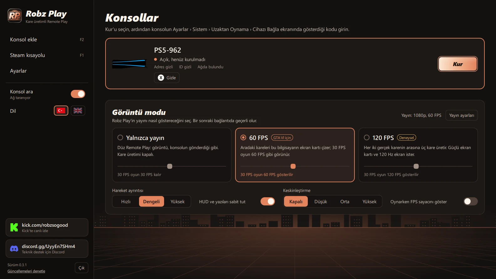
</p>
<p align="center">
  <sub>Ana ekran. Konsol kartında "Adres gizli" ve "ID gizli" yazıyor: görüntü alınırken yayıncı modu açıktı.</sub>
</p>

> [!TIP]
> **chiaki-ng kullanıyor musun?** Robz Play ilk açılışta chiaki-ng'nin ayarlarını ve kayıtlı konsollarını kendiliğinden alır; konsolun zaten bağlıysa 6. adımı atla. chiaki-ng'de ne seçili olursa olsun kare üretimi açık, 60 FPS ve Vulkan seçili gelir. chiaki-ng'nin kendi ayarlarına dokunulmaz.

#### 6. Konsolu bağla (bir kez)

Konsolun kartındaki **Kur**'a bas.

<p align="center">
  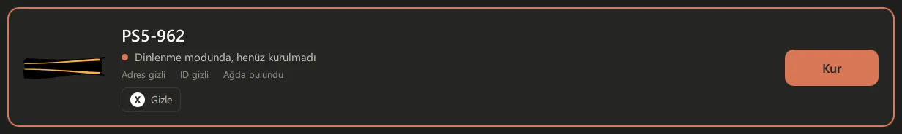
</p>

Açılan **Konsolu kaydet** ekranında:

1. **PSN girişi**'ne bas ve PlayStation hesabınla giriş yap.
2. PS5'te **Ayarlar › Sistem › Uzaktan Oynama › Cihazı Bağla**'yı seç; ekranda bir kod çıkar.
3. O kodu **Remote Play PIN'i** alanına yaz ve sağ üstteki **Kaydet**'e bas.

<p align="center">
  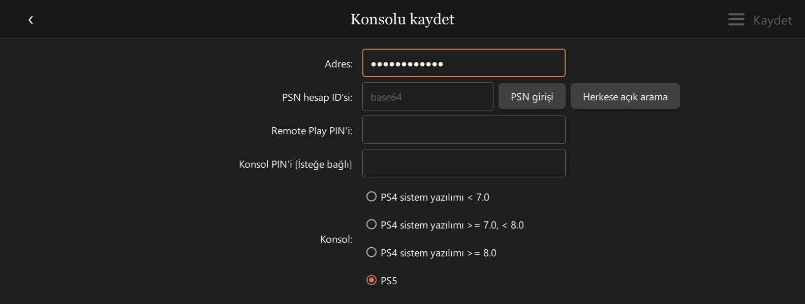
</p>
<p align="center">
  <sub>Konsolu kaydet ekranı. Adres alanı yayıncı modunda gizli görünür.</sub>
</p>

#### 7. Görüntü modunu seç

GTA VI için **60 FPS**'i seç; varsayılan mod budur. Kare üretimi istemiyorsan **Yalnızca yayın**, güçlü bir kartın ve 120 Hz ekranın varsa deneysel **120 FPS**. Mod bir sonraki bağlantıda geçerli olur. Altındaki **Hareket ayrıntısı**, **HUD ve yazıları sabit tut**, **Keskinleştirme** ve **FPS sayacı** da buradan değişir.

<p align="center">
  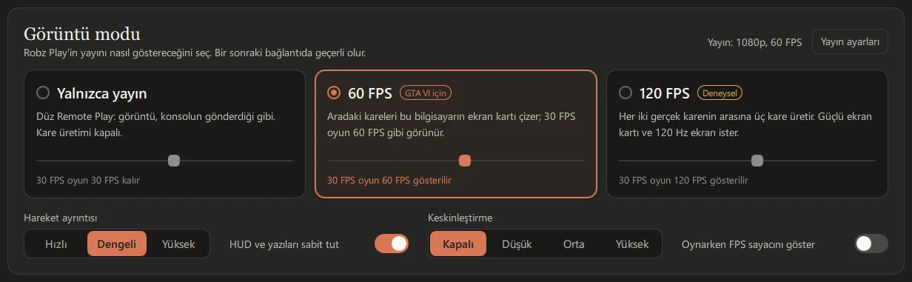
</p>

#### 8. Oyna

Konsol kaydedildikten sonra kartında **Oyna** düğmesi çıkar. Bastığında Robz Play PS5'e bağlanır; 4. adımdaki dinlenme modu ayarları açıksa uyuyan konsol da uyandırılır. Bağlantı kurulunca oyun görüntüsü gelir.

<p align="center">
  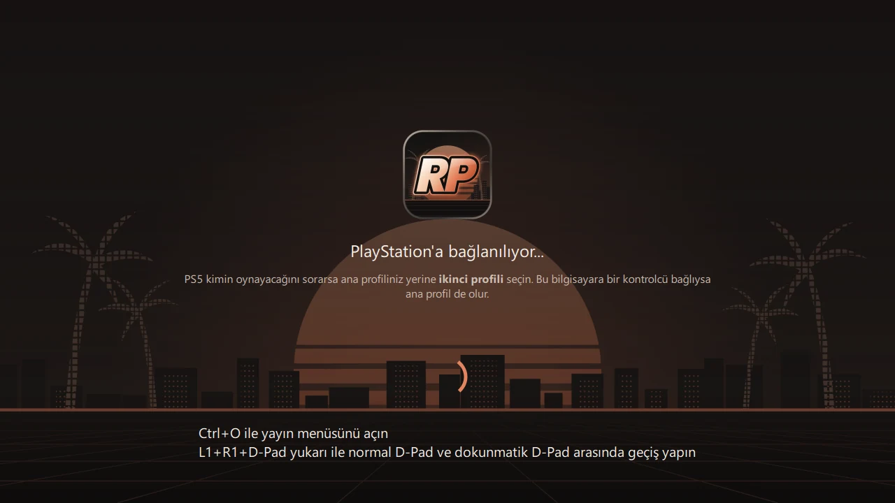
</p>
<p align="center">
  <sub>Bağlanırken görünen ekran.</sub>
</p>

#### 9. Oyun sırasında: yayın menüsü

`Ctrl + O` yayın menüsünü açar: ses düzeyi, mikrofon, yakınlaştırma, keskinleştirme, FPS sayacı ve görüntü işleyici ayarları oyunu bırakmadan değişir.

<p align="center">
  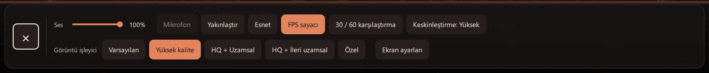
</p>
<p align="center">
  <sub>Yayın menüsü, ekranın altında açılır.</sub>
</p>

#### 10. Ayarlar

Sol menüdeki **Ayarlar**'da kare üretimi, görüntü, yayın, ses, konsollar, klavye ve kontrolcü ayarları bulunur. Parantez içindeki değerler varsayılandır. **Yayın** sayfasında ev içi (Yerel) ve ev dışı (Uzak) bağlantı için çözünürlük, FPS, bit hızı ve kodek ayrı ayrı seçilir.

<p align="center">
  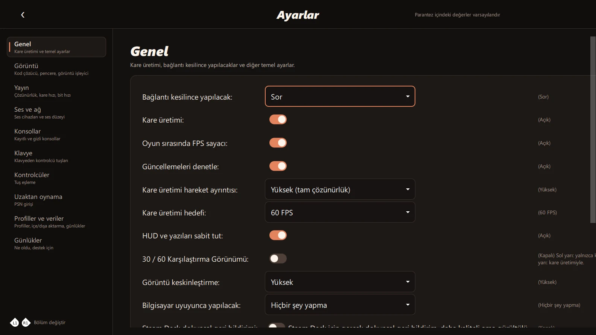
</p>
<p align="center">
  <sub>Genel: kare üretimi ve temel ayarlar.</sub>
</p>

<p align="center">
  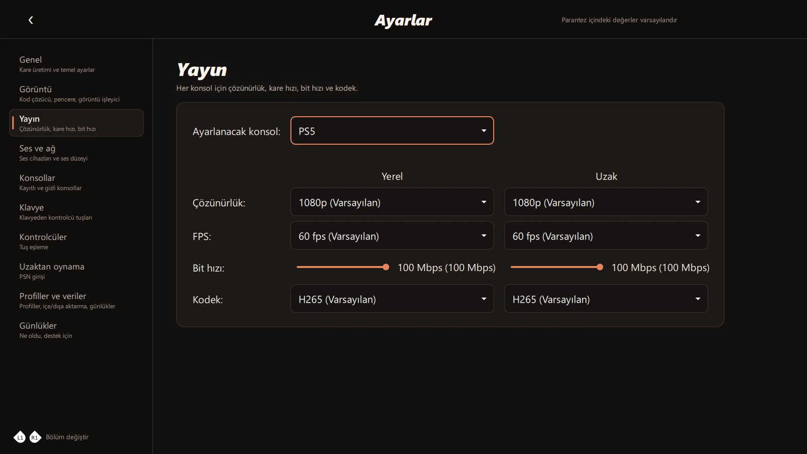
</p>
<p align="center">
  <sub>Yayın: 1080p, 60 FPS, 100 Mbps, H265.</sub>
</p>

### Güncelleme ve kaldırma

- **Güncellemek için** bir şey yapman gerekmez. Yeni bir sürüm çıktığında Robz Play bir **Yenilikler** penceresinde değişiklikleri gösterir; **Şimdi güncelle** yeni sürümü indirir, kurar ve uygulamayı yeniden açar. Uygulama açılışta ve birkaç saatte bir kendisi bakar; beklemek istemezsen sol alttaki sürüm numarasının altındaki **Güncellemeleri denetle** bağlantısına bas. Güncelsen "Robz Play güncel" yazar. İstersen yeni `RobzPlay-Setup.exe` dosyasını indirip çalıştırman da yeter. Ayarların ve kayıtlı konsolların her durumda korunur.
- **Kaldırmak için** Windows'un "Yüklü uygulamalar" listesinden Robz Play'i kaldır. Ayarların Windows kayıt defterinde kalır.

<details>
<summary><b>Kaynaktan derlemek</b> (geliştiriciler için)</summary>

1. [MSYS2](https://www.msys2.org/)'yi varsayılan konumuna (`C:\msys64`) kur ve **MSYS2 MINGW64** kabuğunu aç.
2. Depoyu alt modülleriyle birlikte indir:

   ```bash
   git clone -c core.autocrlf=false --recursive https://github.com/kutsalkiremitci/robz-play.git
   cd robz-play
   ```

3. Bağımlılıkları bir kez kur (uzun sürer), sonra derle:

   ```bash
   ./scripts/robzplay-setup-msys2.sh
   ./scripts/robzplay-build.sh
   ```

4. Depo klasöründeki **`start.bat`** dosyasına çift tıkla. Uygulama `dist\RobzPlay` klasöründen açılır.

Yayınlanan kurulum dosyasını (`RobzPlay-Setup.exe`) ve taşınabilir zip paketini üretmek için: `./scripts/robzplay-package.sh`.

</details>

## Üç görüntü modu

Ana ekranın ortasında. Kare üretimi zorunlu değil: tek tıkla açılır, kapanır ya da hedefi değişir.

| Mod | Ne yapar | 30 FPS çalışan GTA VI'da görülen |
|---|---|:---:|
| **Yalnızca yayın** | Düz Remote Play: 1080p, 60 FPS yayın, konsolun gönderdiği gibi. Kare üretimi kapalı, ek gecikme yok. | 30 FPS |
| **60 FPS** `GTA VI için` | Aradaki kareleri bilgisayarının ekran kartı çizer; 30 FPS oyun 60 FPS gibi görünür. Varsayılan ve önerilen mod. | **60 FPS** |
| **120 FPS** `Deneysel` | Her iki gerçek karenin arasına üç kare üretir. Güçlü bir ekran kartı ve 120 Hz veya üstü bir ekran ister. | 120 FPS |

**Bilmen gerekenler**

- Mod, bir sonraki bağlantıda geçerli olur.
- Zaten 60 FPS çalışan bir oyunda "Yalnızca yayın" ile "60 FPS" aynı görüntüyü verir; fark 30 FPS'e kilitli oyunlarda ortaya çıkar.
- Keskinleştirme ve FPS sayacı anında, kare üretimi ayarları bir sonraki yayında geçerli olur.

### 120 FPS neden deneysel?

- Ekran kartından 60 FPS moduna göre daha fazla güç ister.
- Dört kareden üçü üretilmiş olduğu için hızlı hareketlerde bozulmalar daha kolay fark edilir.
- Yalnızca tek bir sistemde (RTX 4070) denendi. Sorun yaşarsan 60 FPS'e dön; günlük kullanım için önerilen mod odur.

## Ayarlar

### Varsayılan ayarlar

Robz Play bu ayarlarla geliştirilip denendi:

| Görüntü işleyici | Kodek | Çözünürlük | Yayın | Bit hızı | Ses |
|:---:|:---:|:---:|:---:|:---:|:---:|
| **Vulkan** | **H265** | **1080p** | **60 FPS** | **100 Mbps** | **%100** |

Görüntü işleyici olarak Vulkan seçili gelir, çünkü geliştiricinin görüntüden altyazı okuyan diğer uygulaması Robz Vision OpenGL görüntüsünü yakalayamıyor. Ev dışından bağlanırken 100 Mbps çoğu ev internetinin yükleme hızı için fazladır; **Ayarlar › Yayın** sayfasındaki **Uzak** sütununda bit hızını düşür.

### Kare üretimi ayarları

| Ayar | Seçenekler | Ne yapar |
|---|---|---|
| Görüntü modu | Yalnızca yayın / 60 FPS / 120 FPS `Deneysel` | Kare üretimini kapatır ya da hedefini seçer. Ana ekranın ortasındadır. |
| Hareket ayrıntısı | Hızlı / Dengeli / Yüksek | Hareketin hangi çözünürlükte ölçüleceği. Yüksek daha temiz, ama ekran kartına yaklaşık üç kat daha ağır. |
| HUD ve yazıları sabit tut | Açık / Kapalı | Sabit arayüz öğelerini üretilen karelerde korur. |
| Keskinleştirme | Kapalı / Düşük / Orta / Yüksek | Yayının netliğini artırır; anında uygulanır. |
| FPS sayacı | Açık / Kapalı | Sol üstte gösterilen ve kaynak FPS. |

## Öne çıkanlar

| | |
|---|---|
| **1080p, 60 FPS Remote Play** | PS5'ine ev ağından bağlan ve bilgisayarından oyna. Kare üretimi olmadan da kullanılır. |
| **30 → 60 FPS** | GTA VI ve 30 FPS'e kilitli diğer PS5 ve PS4 oyunları 60 FPS akıcılığında. |
| **120 FPS** `Deneysel` | Her iki gerçek karenin arasına üç kare üretir; ayrıntı için [yukarıya bak](#120-fps-neden-deneysel). |
| **HUD ve yazı koruması** | Can göstergesi, mini harita, altyazı gibi sabit öğeler üretilen karelerde yerinde kalır, titremez. |
| **Keskinleştirme** | Sıkıştırılmış yayının kaybettiği netliği geri getirir; oyun sırasında anında değişir. |
| **OBS'de de görünen FPS sayacı** | Gösterilen ve kaynak FPS'i birlikte gösterir. Görüntünün içine çizildiği için kayıtlara da girer. |
| **Yayın içi menü** | `Ctrl + O`: ses, mikrofon, yakınlaştırma, keskinleştirme, FPS sayacı. |
| **Türkçe ve İngilizce** | Uygulama Türkçe açılır; sol menüdeki bayraklardan dil değişir. |
| **Güncelleme bildirimi** | Yeni bir sürüm çıktığında "Yenilikler" penceresi değişiklikleri senin dilinde gösterir; "Şimdi güncelle" indirir, kurar ve uygulamayı yeniden açar. "Güncellemeleri denetle" ile istediğin an kendin de bakarsın. |
| **Teknik destek için Discord** | Sol menüdeki Discord düğmesiyle tek tıkla ücretsiz teknik desteğe ulaşırsın. |
| **Açılış günlüğü** | Her açılış bir günlük dosyasına yazılır; bir sorun olursa nerede olduğu görülür. |
| **chiaki-ng'den geçiş** | İlk açılışta chiaki-ng'nin ayarlarını ve kayıtlı konsollarını alır. chiaki-ng'nin kendi ayarlarına dokunulmaz. |
| **Remote Play'in tamamı** | [chiaki-ng](https://github.com/chiaki-ng/chiaki-ng) temelli: DualSense desteği, PSN üzerinden ev dışından bağlanma, tuş eşleme, profiller. |

## Nasıl çalışır?

PS5 oyunu yine 30 FPS çalıştırır. Akıcılaşan, senin ekranında gördüğün görüntüdür.

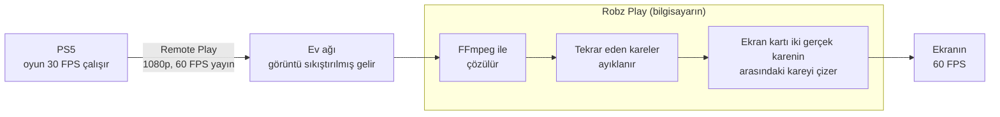

1. **PS5:** oyun 30 FPS çalışır. Görüntü Remote Play ile 1080p, 60 FPS yayın olarak gönderilir; her kare iki kez gelir.
2. **Ev ağı:** görüntü bilgisayarına sıkıştırılmış gelir ve FFmpeg ile çözülür.
3. **Robz Play:** tekrar eden kareler ayıklanır; ekran kartı iki gerçek karenin arasındaki kareyi çizer.
4. **Ekranın:** saniyede 30 gerçek + 30 üretilen kare, eşit aralıklarla. Sonuç 60 FPS.

### Ara kare nereden geliyor?

- Robz Play, yayındaki kopyaları ayıklayıp oyunun gerçek 30 karesini bulur.
- Ekran kartında çalışan bir yapay zekâ modeli, **RIFE v4.6**, art arda gelen iki gerçek karedeki hareketi ölçer ve tam aradaki kareyi çizer. Model [ncnn](https://github.com/Tencent/ncnn) ve Vulkan ile çalışır; bu yüzden NVIDIA, AMD ve Intel kartlarda çalışabilir.
- Can göstergesi, mini harita, altyazı gibi **sabit duran HUD öğeleri ayrıca korunur**; hareket eden arka planın üstünde titremezler.
- Kart bir kareye yetişemezse Robz Play o kareyi üretmeyi atlar; görüntü donmaz.

### Ne işe yarar, ne değildir?

**Yararı**

- GTA VI gibi 30 FPS'e kilitli oyunlarda kamera dönüşleri, araç sürüşü ve hareket gözle görülür biçimde akıcılaşır.
- Ek donanım istemez. Capture card, HDMI ayırıcı, ikinci bir cihaz yok.
- Ücretsiz ve açık kaynak; ne yaptığı kodda okunabilir.

**Ne değildir**

- **PS5'i hızlandırmaz.** Oyun konsolda yine 30 FPS çalışır; akıcılaşan, senin ekranında gördüğün görüntüdür.
- **Gecikmeyi azaltmaz, biraz artırır.** Remote Play'in kendi gecikmesine ek olarak, ara kareyi çizebilmek için bir sonraki gerçek kare beklenir (30 FPS'te yaklaşık 33 ms). Tek kişilik oyunlarda rahat oynanır; rekabetçi oyunlar için uygun değildir.
- **HDMI kalitesi değildir.** Görüntü ağ üzerinden sıkıştırılarak gelir; televizyona doğrudan bağlı PS5 kadar net olmaz. Keskinleştirme farkı azaltır, yok etmez.
- **Kusursuz değildir.** Çok hızlı hareketlerde ve ince desenlerde üretilen karelerde bozulmalar görülebilir.
- **Resmî bir ürün değildir.** Sony Interactive Entertainment, PlayStation, Rockstar Games ya da Take-Two ile hiçbir bağı yoktur; onlar tarafından onaylanmamıştır.

## Kullanılan teknolojiler

Robz Play, açık kaynağın omuzlarında durur. Bu projelerin geliştiricilerine teşekkürler.

| Proje | Robz Play'deki işi |
|---|---|
| [chiaki-ng](https://github.com/chiaki-ng/chiaki-ng) ve ondan önce Florian Märkl'in [Chiaki](https://git.sr.ht/~thestr4ng3r/chiaki)'si | Remote Play bağlantısının tamamı |
| [Qt 6 / QML](https://www.qt.io/) | Arayüz |
| [libplacebo](https://code.videolan.org/videolan/libplacebo) + Vulkan | Görüntü işleme ve ekrana çizim |
| [FFmpeg](https://ffmpeg.org/) | Yayının çözülmesi |
| [RIFE](https://github.com/hzwer/Practical-RIFE) v4.6 (hzwer), [rife-ncnn-vulkan](https://github.com/nihui/rife-ncnn-vulkan) (nihui) ve [ncnn](https://github.com/Tencent/ncnn) | Kare üretimi, ekran kartında |
| [NSIS](https://nsis.sourceforge.io/) | Kurulum dosyası |
| [MSYS2](https://www.msys2.org/) / MinGW | Windows için derleme |

## Sık sorulanlar ve sorun giderme

Cevabı burada bulamazsan [Discord sunucumuza](https://discord.gg/UyyEn7SHm4) yaz; kurulum desteği ücretsiz. Uygulamanın sol menüsündeki **Teknik destek için Discord** düğmesi de oraya götürür.

### Kurulum ve açılış

<details>
<summary><b>Windows "kişisel bilgisayarınızı korudu" diyor</b></summary>

Kurulum dosyası henüz imzalı olmadığı için Windows bu uyarıyı gösterebilir. **Ek bilgi**'ye, ardından **Yine de çalıştır**'a bas. İmzalı kurulum dosyası yol haritasında.

</details>

<details>
<summary><b>Robz Play açılmıyor ya da hata veriyor</b></summary>

Önce en son sürümü kur: Windows kullanıcı adında ğ, ı, ş gibi Türkçe harfler olan bilgisayarlardaki açılış sorunu 0.3.0'da düzeltildi. Sorun sürerse günlüklere bak ve tanı dosyasını hazırla (aşağıda).

</details>

<details>
<summary><b>Günlükler (log) nerede?</b></summary>

Başlat menüsündeki **"Robz Play günlükleri"** kısayolu günlük klasörünü açar: `%APPDATA%\RobzPlay\RobzPlay\log`

- `robzplay-acilis.log`: her açılışta yazılır; bir önceki açılış `robzplay-acilis-onceki.log` olarak saklanır. Uygulama çökerse son satırda hangi dosyada çöktüğü yazar.
- `chiaki_session_….log`: her yayının kendi günlüğü.

</details>

<details>
<summary><b>Destek isterken hangi dosyayı göndereyim?</b></summary>

Kurulum klasöründeki (`%LOCALAPPDATA%\Programs\Robz Play`) **`Tani.bat`** dosyasına çift tıkla. Bilgisayarın, ekran kartının ve son açılışların bilgisini masaüstüne `robzplay-tani.txt` olarak yazar. Bu dosyayı Discord'da sorununu anlatırken ekle.

</details>

<details>
<summary><b>chiaki-ng kullanıyorum, baştan mı kuracağım?</b></summary>

Hayır. Robz Play ilk açılışta chiaki-ng'nin ayarlarını ve kayıtlı konsollarını kendiliğinden alır; konsolu yeniden bağlaman gerekmez. chiaki-ng'nin kendi ayarlarına dokunulmaz.

</details>

<details>
<summary><b>Nasıl güncellerim, nasıl kaldırırım?</b></summary>

Yukarıdaki [Güncelleme ve kaldırma](#güncelleme-ve-kaldırma) bölümüne bak.

</details>

### Bağlantı ve görüntü

<details>
<summary><b>"Oyna"ya basınca kontrolcünün bağlantısı kopuyor</b></summary>

Yayın açılıyor ama DualSense oyunda çalışmıyor ya da bağlantısı kopuyorsa, bunun sebebi PS5'te yalnızca bir kullanıcı profili olması. Robz Play, chiaki-ng ile aynı Remote Play bağlantısını kullanır ve bu bağlantıda uzaktan gelen kontrolcü için konsolda ikinci bir kullanıcı profili gerekiyor. Yani sorun kare üretiminden değil, Remote Play'in (ve chiaki-ng'nin) bu davranışından kaynaklanıyor.

Çözüm:

1. PS5'te yeni bir kullanıcı profili (ikinci bir hesap) ekle: ana ekranda sağ üstteki profil simgesini aç (ya da PS düğmesiyle kontrol merkezini aç), **Kullanıcı Değiştir**'i, ardından **Kullanıcı Ekle**'yi seç.
2. Robz Play'de yeniden **Oyna**'ya bas. PS5 bu kez iki profilin olduğu bir profil seçme ekranı gösterir.
3. Yeni oluşturduğun profili seç ve devam et; kontrolcü çalışır.

**GTA VI için önemli:** ana hesabınla satın aldığın bir oyunu yeni profille oynayabilmek için ana hesapta o PS5 için **Konsol Paylaşımı ve Çevrimdışı Oynama** açık olmalı: PS5'te ana hesapla **Ayarlar › Kullanıcılar ve Hesaplar › Diğer › Konsol Paylaşımı ve Çevrimdışı Oynama**. Konsolda ilk kurulan hesapta bu genellikle zaten açıktır.

Menü adları PS5 sistem yazılımının sürümüne göre biraz farklı olabilir. Bu adımlardan sonra bağlantı hâlâ kopuyorsa Discord'da sor ve `robzplay-tani.txt` dosyasını ekle.

</details>

<details>
<summary><b>Konsolum ana ekranda görünmüyor</b></summary>

PS5'te Uzaktan Oynama'nın açık olduğundan (**Ayarlar › Sistem › Uzaktan Oynama**) ve PS5 ile bilgisayarın aynı ağda olduğundan emin ol. Ana ekranın solundaki **Konsol ara** anahtarı açık olmalı. Konsol dinlenme modundaysa **Ayarlar › Sistem › Güç Tasarrufu › Dinlenme Modunda Kullanılabilen Özellikler** bölümündeki iki seçenek de açık olmalı.

</details>

<details>
<summary><b>Görüntü takılıyor ya da bozuluyor</b></summary>

PS5'i ve bilgisayarı kabloyla modeme (router) bağla. Kablolu bağlantı en dengeli görüntüyü verir; Wi-Fi'da takılma daha sık görülür.

</details>

<details>
<summary><b>Ekran kartım zorlanıyor</b></summary>

Ana ekrandaki **Hareket ayrıntısı** ayarını "Hızlı"ya al. Hareket, görüntünün dörtte biri çözünürlükte ölçülür ve iş yükü belirgin biçimde düşer. Kare üretimi yetişemediği anlarda Robz Play kare üretmeyi kendiliğinden atlar; görüntü donmaz. 120 FPS kullanıyorsan 60 FPS'e dön.

İşlemcinin içindeki tümleşik grafik kare üretimi için yetmez; Vulkan destekli ayrı bir ekran kartı gerekir. Kare üretimi olmadan oynamak için "Yalnızca yayın" modunu seç.

</details>

<details>
<summary><b>Üretilen karelerde bozulma görüyorum</b></summary>

Hareket görüntüden tahmin edildiği için çok hızlı hareketlerde ve ince desenlerde üretilen karelerde bozulmalar görülebilir. 120 FPS modunda dört kareden üçü üretildiği için daha belirgindir. **HUD ve yazıları sabit tut** açık kalsın. Kartın kaldırıyorsa **Hareket ayrıntısı**'nı "Yüksek"e alabilirsin: daha temiz sonuç verir, ama ekran kartına yaklaşık üç kat daha ağırdır.

</details>

<details>
<summary><b>Gecikme var mı? Rekabetçi oyunlarda kullanılır mı?</b></summary>

Kare üretimi biraz gecikme ekler: ara kareyi çizebilmek için bir sonraki gerçek kare beklenir (30 FPS'te yaklaşık 33 ms), Remote Play'in kendi gecikmesine ek olarak. Tek kişilik oyunlarda rahat oynanır; rekabetçi oyunlar için uygun değildir. Gecikmenin önemli olduğu oyunlarda "Yalnızca yayın" modunu seç.

</details>

<details>
<summary><b>Ev dışından bağlanabilir miyim?</b></summary>

Evet, Remote Play PSN hesabıyla ev dışından bağlanmayı destekler (**Ayarlar › Uzaktan oynama › PSN'e giriş yap**). Ama varsayılan 100 Mbps çoğu ev internetinin yükleme hızı için fazla: **Ayarlar › Yayın** sayfasındaki **Uzak** sütununda bit hızını düşür. Zayıf bağlantıda görüntü kalitesi ve gecikme kötüleşir.

</details>

### Genel

<details>
<summary><b>Capture card gerekiyor mu?</b></summary>

Hayır. Görüntü PS5'ten ağ üzerinden, Remote Play ile gelir.

</details>

<details>
<summary><b>Bu DLSS mi? Ekran kartım NVIDIA değil.</b></summary>

Hayır, DLSS değildir ve NVIDIA'ya ya da AMD'ye özel bir teknoloji kullanmaz. Kare üretimini açık kaynak RIFE v4.6 modeli ncnn ve Vulkan ile yapar; Vulkan destekleyen ayrı ekran kartlarında (NVIDIA GTX/RTX, AMD Radeon RX, Intel Arc) çalışır. Şimdiye kadar yalnızca RTX 4070 ile denendi.

DLSS oyunun içinde çalışır ve hareket bilgisini oyun motorundan alır. GTA VI ise PS5'te çalışıyor; bilgisayara yalnızca görüntü geliyor. Robz Play hareketi bu görüntüden tahmin eder. Bu yüzden her marka kartta ve Remote Play'de açılan her oyunda çalışır.

</details>

<details>
<summary><b>Hangi oyunlarda çalışır?</b></summary>

GTA VI için tasarlandı ve GTA VI oynanarak geliştirildi, ama Remote Play'in izin verdiği bütün PS5 ve PS4 oyunlarında çalışır. En büyük fark 30 FPS'e kilitli oyunlarda görülür; zaten 60 FPS çalışan bir oyunda 60 FPS modu bir şey eklemez.

</details>

<details>
<summary><b>OBS ile yayın ya da kayıt yapabilir miyim?</b></summary>

Evet. Robz Play penceresini oyun yakalama kaynağı olarak ekle; üretilen kareler ve FPS sayacı kayda girer.

</details>

<details>
<summary><b>HDR destekleniyor mu?</b></summary>

Kare üretimi HDR yayınla henüz denenmedi.

</details>

<details>
<summary><b>Ücretli mi? Resmî bir uygulama mı?</b></summary>

Ücretsiz ve açık kaynaktır (AGPL-3.0). Resmî bir ürün değildir: Sony Interactive Entertainment, Rockstar Games ya da Take-Two Interactive ile bağı yoktur ve onlar tarafından onaylanmamıştır.

</details>

## Yol haritası

- İmzalı kurulum dosyası.
- İlk açılışta ekran kartı hız testi ve buna göre otomatik ayar.
- Eklenen gecikmeyi azaltma.
- Gerçek oyun görüntüleriyle kalite ayarı; daha fazla ekran kartında deneme.

## Geliştirenler için

- Kare üretimi çekirdeği `robzfg/` klasöründedir: RIFE v4.6 modeli, [ncnn](https://github.com/Tencent/ncnn) ve Vulkan ile çalışır. `robzfg-lab` aracıyla hız ve kalite ölçülür.
- Arayüz Qt 6 / QML'dir (`gui/src/qml`). Çeviriler tek bir dosyadadır: `gui/res/i18n/tr.json`. Eksik çevirileri `python gui/tools/i18n_extract.py` listeler.
- Arayüzü konsol olmadan görmek için `ROBZPLAY_UI_PREVIEW` ortam değişkeni (`stream-loading`, `stream-menu`, `home-empty`), ayarlarına dokunmadan denemek için `ROBZPLAY_SETTINGS_ORG` kullanılır.
- Bilgisayarda kare üretimini PS5 olmadan sınamak için: `ROBZPLAY_FRAMEGEN_SELFTEST=1`.
- Güncelleme denetimini sınamak için: `ROBZPLAY_UPDATE_URL` başka bir sürüm kaynağını, `ROBZPLAY_VERSION_OVERRIDE` uygulamanın kendini başka bir sürüm sanmasını sağlar. Sürüm notları `<!-- robzplay:tr -->`, `<!-- robzplay:en -->` ve `<!-- robzplay:end -->` satırlarıyla dillere ayrılır.

## Lisans

**Robz Play, [chiaki-ng](https://github.com/chiaki-ng/chiaki-ng) 1.10.1'in değiştirilmiş bir sürümüdür.** Değişiklikler 20 Kasım 2026'da başladı ve tamamı bu deponun commit geçmişinde görülebilir (chiaki-ng'den devralınan son commit: `43728af2`). Robz Play, chiaki-ng ya da Chiaki geliştiricileri tarafından hazırlanmamıştır ve onlar tarafından onaylanmamıştır; Robz Play ile ilgili sorunları onlara değil, [bu depoya](https://github.com/kutsalkiremitci/robz-play/issues) bildir.

Robz Play, chiaki-ng gibi **AGPL-3.0-only** (OpenSSL istisnasıyla) lisanslıdır; tam metin [`LICENSES`](LICENSES) klasöründe ve [`COPYING`](COPYING) dosyasındadır. RIFE modeli ve rife-ncnn-vulkan kodu MIT lisanslıdır; lisans metinleri ilgili klasörlerde durur.

PlayStation, PS5, PS4 ve DualSense, Sony Interactive Entertainment'ın markalarıdır. Grand Theft Auto ve GTA, Take-Two Interactive'in markalarıdır; bu sayfadaki oyun görüntüleri Rockstar Games'e aittir ve yalnızca Robz Play'in çalışmasını göstermek için kullanılmıştır. Bu proje Sony Interactive Entertainment, Rockstar Games ya da Take-Two Interactive tarafından onaylanmamış ya da desteklenmemiştir.

---

<p align="center">
  Web sitesi: <a href="https://kutsalkiremitci.github.io/robz-play/"><b>kutsalkiremitci.github.io/robz-play</b></a> · Canlı yayınlar: <a href="https://kick.com/robzsogood"><b>kick.com/robzsogood</b></a> · Teknik destek: <a href="https://discord.gg/UyyEn7SHm4"><b>Discord</b></a>
</p>
