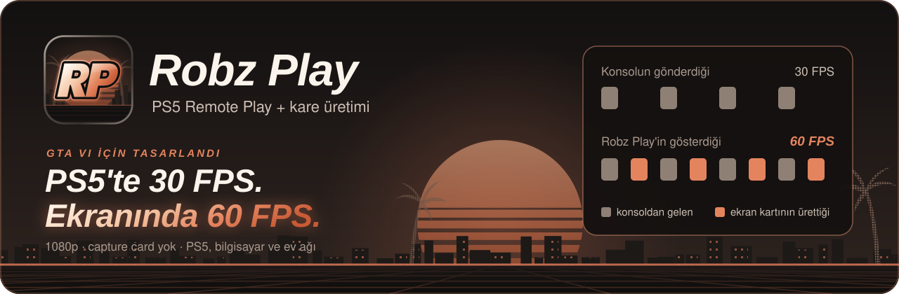
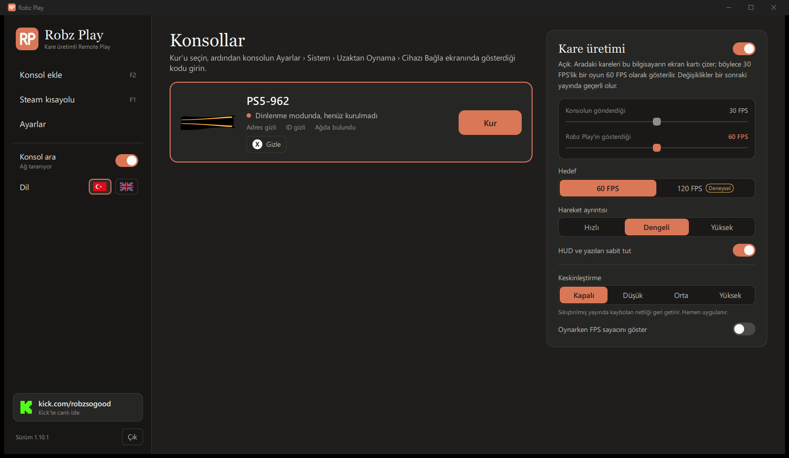
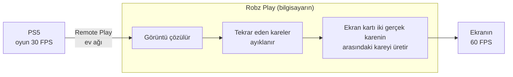
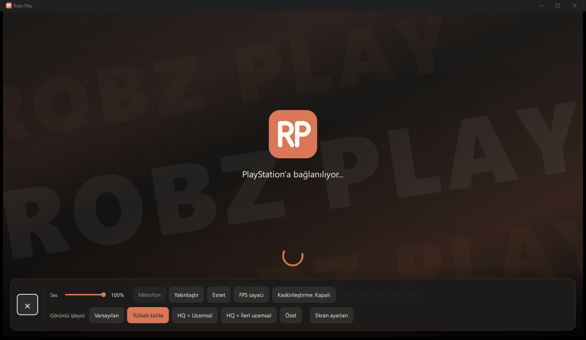
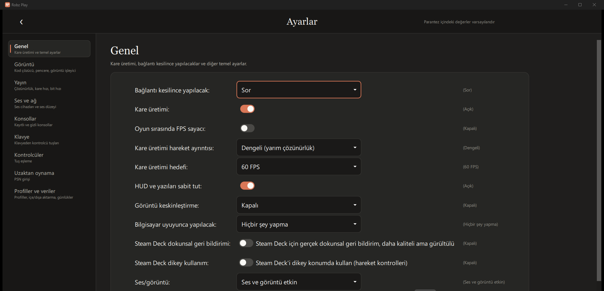

<p align="center">
  
</p>

<p align="center">
  
  
  
  
  <a href="https://kick.com/robzsogood"></a>
</p>

# Robz Play

**Robz Play, PlayStation'ını ev ağı üzerinden bilgisayarına bağlar ve 30 FPS çalışan oyunu ekranında 60 FPS akıcılığında gösterir.** Aradaki kareleri bilgisayarının ekran kartı üretir. Capture card gerekmez: PS5, bilgisayar ve ikisinin bağlı olduğu ağ yeterli.

Projenin çıkış noktası tek bir cümle: **PS5'te 30 FPS çalışan GTA VI'yı, PC üzerinden PS Remote Play ile 60 FPS akıcılığında oynamak.** Robz Play bunun için yazıldı; aynı yöntem 30 FPS'e kilitli bütün PS5 ve PS4 oyunlarında işe yarar.

<p align="center">
  
</p>

## Nasıl çalışır?



1. PS5 görüntüyü Remote Play ile bilgisayara yollar. Oyun 30 FPS olsa da yayın 60 FPS gelir; her kare iki kez gönderilir.
2. Robz Play bu kopyaları ayıklar ve oyunun gerçek 30 karesini bulur.
3. Ekran kartında çalışan bir yapay zekâ modeli (RIFE), art arda gelen iki gerçek karedeki hareketi ölçer ve tam aradaki kareyi çizer.
4. Gerçek ve üretilen kareler eşit aralıklarla ekrana verilir: saniyede 30 gerçek + 30 üretilen = 60 kare.

Can göstergesi, mini harita, altyazı gibi **sabit duran HUD öğeleri ayrıca korunur**; hareket eden arka planın üstünde titremezler.

## Öne çıkanlar

| | |
|---|---|
| **30 → 60 FPS** | 30 FPS oyunlar 60 FPS akıcılığında. Varsayılan ve önerilen mod. |
| **120 FPS** `Deneysel` | Her iki gerçek karenin arasına üç kare üretir. Güçlü ekran kartı ve 120 Hz ekran ister; ayrıntı için [aşağıya bak](#120-fps-deneysel). |
| **HUD ve yazı koruması** | Sabit arayüz öğeleri üretilen karelerde yerinde kalır. |
| **Keskinleştirme** | Sıkıştırılmış yayının kaybettiği netliği geri getirir; oyun sırasında anında değişir. |
| **FPS sayacı** | Gösterilen ve kaynak FPS'i birlikte gösterir. Görüntünün içine çizilir, OBS kayıtlarında da görünür. |
| **Yayın içi menü** | `Ctrl+O` ile açılır: ses, mikrofon, yakınlaştırma, keskinleştirme, FPS sayacı, bağlantı değerleri. |
| **Türkçe ve İngilizce** | Uygulama Türkçe açılır; ana ekrandaki bayraklardan dil değişir. |
| **Remote Play'in tamamı** | [chiaki-ng](https://github.com/chiaki-ng/chiaki-ng) temelli: DualSense desteği, PSN üzerinden ev dışından bağlanma, tuş eşleme, profiller. |

<p align="center">
  
</p>

## Kimler kullanabilir?

Gerekenler:

- **PlayStation 5** (PS4 de olur), Uzaktan Oynama açık.
- **Windows 10 veya 11** yüklü, 64 bit bir bilgisayar.
- **Vulkan destekli ayrı bir ekran kartı.** Kare üretimini ekran kartı yapar; işlemcinin içindeki tümleşik grafik yetmez.
- PS5 ile bilgisayarın **aynı ağda** olması. Kablolu bağlantı en dengeli görüntüyü verir.
- 60 FPS için 60 Hz, 120 FPS için 120 Hz veya üstü bir ekran.

RTX 4070 şart değil, ama ekran kartının bir kareyi yaklaşık 10 milisaniyenin altında üretebilmesi gerekiyor. Aşağıdaki tabloda **yalnızca RTX 4070 satırı gerçekten ölçüldü**; diğer satırlar tahmindir ve denendikçe güncellenecek.

| Ekran kartı | Beklenti | Durum |
|---|---|---|
| Tümleşik grafik (Intel UHD, AMD Radeon Graphics) | Çalışmaz: bir kare saniyeler sürüyor | Ölçüldü (AMD tümleşik: ~2,7 sn/kare) |
| Giriş seviyesi ayrı kart (GTX 1650 sınıfı) | 60 FPS, "Hızlı" ayrıntı modunda mümkün olabilir | Tahmin, denenmedi |
| Orta seviye (RTX 3060, RX 6600 XT sınıfı ve üstü) | 60 FPS, "Dengeli" modda | Tahmin, denenmedi |
| RTX 4070 | 60 FPS "Dengeli": kare başına ~5-10 ms. 120 FPS deneysel olarak çalışıyor | Ölçüldü |

Kartın zorlanırsa **Hareket ayrıntısı** ayarını "Hızlı"ya al: hareket, görüntünün dörtte biri çözünürlükte ölçülür ve iş yükü belirgin biçimde düşer. Kare üretimi yetişemediği anlarda Robz Play kare üretmeyi kendiliğinden atlar, görüntü donmaz.

## Ne işe yarar, ne değildir?

**Yararı**

- 30 FPS'e kilitli oyunlarda kamera dönüşleri ve hareket gözle görülür biçimde akıcılaşır.
- Ek donanım istemez. Capture card, HDMI ayırıcı, ikinci bir cihaz yok.
- Ücretsiz ve açık kaynak; ne yaptığı kodda okunabilir.

**Ne değildir**

- **PS5'i hızlandırmaz.** Oyun konsolda yine 30 FPS çalışır; akıcılaşan, senin ekranında gördüğün görüntüdür.
- **Gecikmeyi azaltmaz, artırır.** Remote Play'in kendi gecikmesine ek olarak, ara kareyi çizebilmek için bir sonraki gerçek kareyi beklemek gerekir (30 FPS'te yaklaşık 33 ms). Tek kişilik oyunlarda rahat oynanır; rekabetçi oyunlar için uygun değildir.
- **HDMI kalitesi değildir.** Görüntü ağ üzerinden sıkıştırılarak gelir; televizyona doğrudan bağlı PS5 kadar net olmaz. Keskinleştirme bunu azaltır, yok etmez.
- **Kusursuz değildir.** Üretilen karelerde, özellikle çok hızlı hareketlerde ve ince desenlerde bozulmalar görülebilir.
- **Resmî bir ürün değildir.** Sony Interactive Entertainment, PlayStation, Rockstar Games ya da Take-Two ile hiçbir bağı yoktur; onlar tarafından onaylanmamıştır.

## Kurulum

Hazır kurulum paketi henüz yok; şimdilik kaynaktan derleniyor. Paket [yol haritasında](#yol-haritası).

1. [MSYS2](https://www.msys2.org/)'yi varsayılan konumuna (`C:\msys64`) kur ve **MSYS2 MINGW64** kabuğunu aç.
2. Depoyu alt modülleriyle birlikte indir:

   ```bash
   git clone -c core.autocrlf=false --recursive https://github.com/kutsalkiremitci/RobzPlay.git
   cd RobzPlay
   ```

3. Bağımlılıkları bir kez kur (uzun sürer), sonra derle:

   ```bash
   ./scripts/robzplay-setup-msys2.sh
   ./scripts/robzplay-build.sh
   ```

4. Depo klasöründeki **`start.bat`** dosyasına çift tıkla. Uygulama `dist\RobzPlay` klasöründen açılır.

## İlk kullanım

1. PS5'te **Ayarlar › Sistem › Uzaktan Oynama** bölümünden **Uzaktan Oynamayı Etkinleştir**'i aç.
2. PS5 ve bilgisayar aynı ağdayken Robz Play'i aç; konsol ana ekranda kendiliğinden görünür.
3. **Kur**'a bas ve PS5'in **Cihazı Bağla** ekranında gösterdiği kodu yaz. Bu adım bir kez yapılır.
4. **Oyna**'ya bas. Kare üretimi varsayılan olarak açık ve 60 FPS hedefindedir.

Oyun sırasında `Ctrl+O` yayın menüsünü açar.

<p align="center">
  
</p>

## Kare üretimi ayarları

| Ayar | Seçenekler | Ne yapar |
|---|---|---|
| Kare üretimi | Açık / Kapalı | Kapalıyken yayın konsolun gönderdiği gibi gösterilir. |
| Hedef | 60 FPS / 120 FPS `Deneysel` | Ekranda gösterilecek kare hızı. |
| Hareket ayrıntısı | Hızlı / Dengeli / Yüksek | Hareketin hangi çözünürlükte ölçüleceği. Yüksek daha temiz, ama ekran kartına yaklaşık üç kat daha ağır. |
| HUD ve yazıları sabit tut | Açık / Kapalı | Sabit arayüz öğelerini üretilen karelerde korur. |
| Keskinleştirme | Kapalı / Düşük / Orta / Yüksek | Yayının netliğini artırır; anında uygulanır. |
| FPS sayacı | Açık / Kapalı | Sol üstte gösterilen ve kaynak FPS. |

Kare üretimi ayarları bir sonraki yayında, keskinleştirme ve FPS sayacı anında geçerli olur.

### 120 FPS (Deneysel)

120 FPS modu her iki gerçek karenin arasına üç kare yerleştirir. Çalışıyor, ama **deneysel**:

- Ekran kartından 60 FPS moduna göre daha fazla güç ister.
- 120 Hz veya üstü bir ekran gerekir.
- Dört kareden üçü üretilmiş olduğu için hızlı hareketlerde bozulmalar 60 FPS moduna göre daha kolay fark edilir.
- Yalnızca tek bir sistemde (RTX 4070) denendi.

Sorun yaşarsan 60 FPS'e dön; günlük kullanım için önerilen mod odur.

## Sık sorulanlar

**Capture card gerekiyor mu?**
Hayır. Görüntü PS5'ten ağ üzerinden, Remote Play ile gelir.

**Hangi oyunlarda çalışır?**
Remote Play'in izin verdiği bütün PS5 ve PS4 oyunlarında. En büyük fark 30 FPS'e kilitli oyunlarda görülür. Zaten 60 FPS çalışan bir oyunda 60 FPS hedefi bir şey eklemez.

**OBS ile yayın ya da kayıt yapabilir miyim?**
Evet. Robz Play penceresini oyun yakalama kaynağı olarak ekle; üretilen kareler ve FPS sayacı kayda girer.

**Ev dışından bağlanabilir miyim?**
Remote Play PSN hesabıyla ev dışından bağlanmayı destekler. Kare üretimi bağlantı nasıl olursa olsun çalışır, ama zayıf bağlantıda görüntü kalitesi ve gecikme kötüleşir.

**HDR?**
Kare üretimi HDR yayınla henüz denenmedi.

## Yol haritası

- Derleme gerektirmeyen hazır paket (taşınabilir `.zip`).
- İlk açılışta ekran kartı hız testi ve buna göre otomatik ayar.
- Eklenen gecikmeyi azaltma.
- Gerçek oyun görüntüleriyle kalite ayarı; daha fazla ekran kartında deneme.

## Geliştirenler için

- Kare üretimi çekirdeği `robzfg/` klasöründedir: RIFE v4.6 modeli, [ncnn](https://github.com/Tencent/ncnn) ve Vulkan ile çalışır. `robzfg-lab` aracıyla hız ve kalite ölçülür.
- Arayüz Qt 6 / QML'dir (`gui/src/qml`). Çeviriler tek bir dosyadadır: `gui/res/i18n/tr.json`. Eksik çevirileri `python gui/tools/i18n_extract.py` listeler.
- Arayüzü konsol olmadan görmek için `ROBZPLAY_UI_PREVIEW` ortam değişkeni (`stream-loading`, `stream-menu`, `home-empty`), ayarlarına dokunmadan denemek için `ROBZPLAY_SETTINGS_ORG` kullanılır.
- Bilgisayarda kare üretimini PS5 olmadan sınamak için: `ROBZPLAY_FRAMEGEN_SELFTEST=1`.

## Teşekkür

Robz Play şu açık kaynak projelerin üzerine kuruludur:

- [chiaki-ng](https://github.com/chiaki-ng/chiaki-ng) ve ondan önce Florian Märkl'in [Chiaki](https://git.sr.ht/~thestr4ng3r/chiaki)'si: Remote Play bağlantısının tamamı.
- [RIFE](https://github.com/hzwer/Practical-RIFE) (hzwer) ve [rife-ncnn-vulkan](https://github.com/nihui/rife-ncnn-vulkan) (nihui): kare üretim modeli.
- [ncnn](https://github.com/Tencent/ncnn), [libplacebo](https://code.videolan.org/videolan/libplacebo), [FFmpeg](https://ffmpeg.org/), [Qt](https://www.qt.io/).

## Lisans

Robz Play, chiaki-ng gibi **AGPL-3.0-only** (OpenSSL istisnasıyla) lisanslıdır; tam metin [`LICENSES`](LICENSES) klasöründe ve [`COPYING`](COPYING) dosyasındadır. RIFE modeli ve rife-ncnn-vulkan kodu MIT lisanslıdır; lisans metinleri ilgili klasörlerde durur.

PlayStation, PS5, PS4 ve DualSense, Sony Interactive Entertainment'ın markalarıdır. Bu proje Sony Interactive Entertainment tarafından onaylanmamış ya da desteklenmemiştir.

---

<p align="center">
  Canlı yayınlar: <a href="https://kick.com/robzsogood"><b>kick.com/robzsogood</b></a>
</p>
